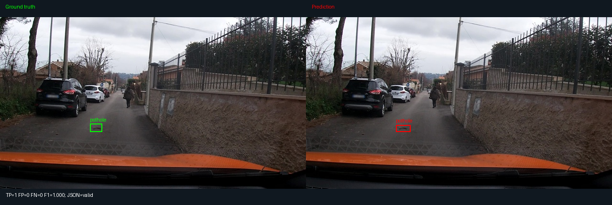
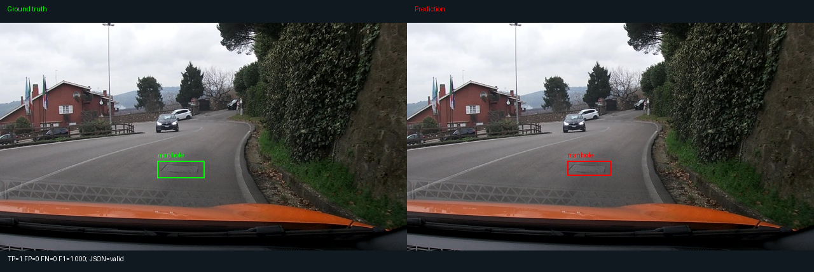
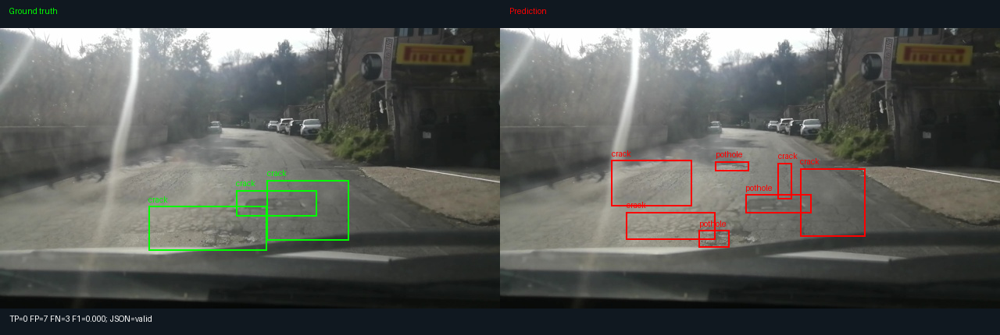
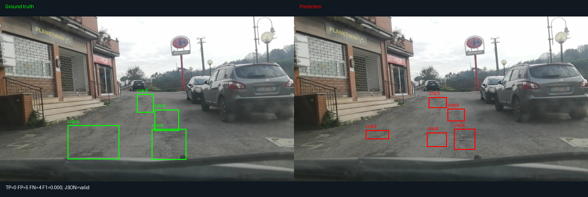
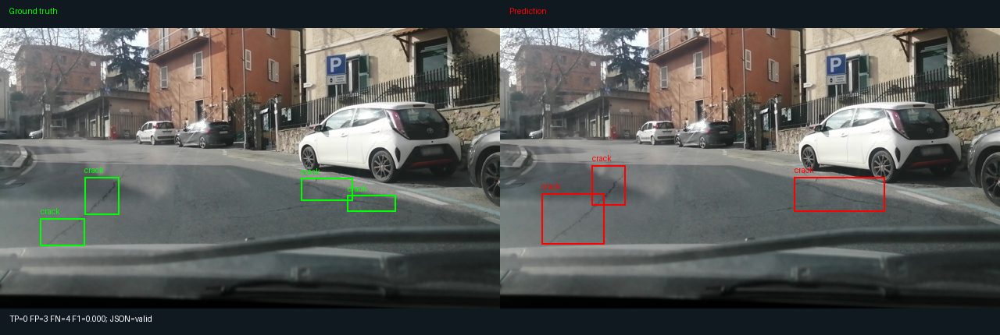
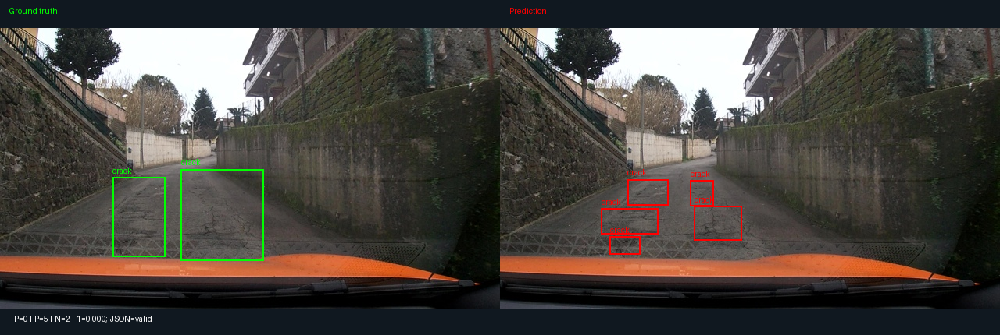

Họ tên: Phạm Xuân Quý
Mã học viên: 2A202602745
`dataset_version`: d10-21e4070301

## Bảng tổng hợp

Kết quả lấy từ [evidence E0–E3](report/evidence/) và [nhật ký huấn luyện](report/runs/), chạy trên Tesla T4. E1–E3 đều dùng 300 bước, batch 2, tích lũy gradient 4 (batch hiệu dụng 8), seed 42, LoRA rank 16/alpha 32, learning rate 0,0002. Mọi kết quả test dùng cùng 311 ảnh, không thiếu dự đoán, tọa độ `norm1000` và scorer gốc ở IoU ≥ 0,5. E0 không lưu phép đo VRAM/thời gian nên để trống. Trường VRAM của mã chạy đo theo GiB (`bytes / 1024**3`), dù tiêu đề của mẫu gọi là GB.

| Mã | Setup | Tham số huấn luyện | VRAM đỉnh (GB) | Phút | F1 | CI95 | FP/ảnh | F1 pothole | F1 crack | F1 manhole |
|---|---|---|---|---|---|---|---|---|---|---|
| E0 | zero-shot | 0 | — | — | 0.0854 | [0.0607, 0.1117] | 1.0096 | 0.0905 | 0.0164 | 0.2160 |
| E1 | LoRA LLM | 33030144 | 10.12 | 46.91 | 0.2444 | [0.2105, 0.2814] | 1.4277 | 0.1659 | 0.1646 | 0.5403 |
| E2 | + projector | 142135296 | 8.17 | 47.85 | 0.3368 | [0.2989, 0.3762] | 1.1736 | 0.2149 | 0.2729 | 0.5891 |
| E3 | + LoRA ViT | 148426752 | 11.62 | 56.42 | 0.4122 | [0.3762, 0.4510] | 1.0482 | 0.2736 | 0.3333 | 0.6947 |

E4 chưa hoàn thành vì giới hạn runtime và thời hạn nộp; E5 tùy chọn được bỏ qua. Báo cáo chỉ trình bày kết quả thực sự đã chạy, không có evidence E4/E5.

## 10 câu hỏi

### Câu 1 — Kiến trúc: ViT, projector và LLM của Qwen3-VL-4B có bao nhiêu tham số mỗi khối, và E1/E2/E3 mỗi cái cập nhật khối nào?
Đếm số phần tử tham số theo kích thước gốc trước khi đóng gói NF4 cho kết quả:

| Khối | Tham số |
|---|---:|
| ViT, không gồm projector | 306.242.560 |
| Projector: merger và deepstack mergers | 109.105.152 |
| LLM, embedding và output head | 4.022.468.096 |
| Tổng | 4.437.815.808 |

ViT cùng projector có 415.347.712 tham số. E1 chỉ cập nhật adapter LoRA trên 252 module attention/MLP của LLM: 33.030.144 tham số. E2 thêm toàn bộ 109.105.152 tham số projector, tổng 142.135.296. E3 thêm adapter trên 96 module attention/MLP của ViT (348 module cùng LLM), tổng 148.426.752. Trọng số nền của LLM và các khối ViT vẫn đóng băng; embedding và `lm_head` không được chọn làm LoRA target. Các số này có trong `architecture`, `matched_modules` và `trainable_params` của từng run.

### Câu 2 — E0: `parse_valid_rate` bằng bao nhiêu, và hai lỗi phổ biến nhất của model gốc là gì (kèm một ví dụ output thô)?
E0 có `parse_valid_rate = 0,8778135`, tức 273/311 ảnh hợp lệ và 38 ảnh không hợp lệ. Hai nhóm lỗi nổi bật là output JSON hỏng và định vị/bỏ sót đối tượng. E0 chỉ có 40 TP, 314 FP, 543 FN; F1 crack chỉ 0,0164. Vì vậy JSON hợp lệ chưa đảm bảo box đúng.

Ví dụ raw output thực tế của ảnh `vlcsnap-2025-02-18-23h07m47s847`:

```text
[{"label":"crack","bbox_2d": [359, 450, 400, 470],"bbox_2d": [359, 470, 400, 490],"bbox_2d": [359, 490, 400, 510],"bbox_2d": [359, 510, 400, 530],"bbox_2d": [359, 530, 400, 550],"bbox_2d": [359, 550, 400, 570],"bbox_2d": [359, 570, 400, 590],"bbox_2d": [359, 590, 400, 610],"bbox_2d": [359, 610, 400, 630],"bbox_2d": [359, 630, 400, 650
```

Output lặp khóa `bbox_2d` và không đóng JSON. Giới hạn sinh là 256 token; việc bị cắt do giới hạn là một khả năng, nhưng không có token count từng output để xác nhận nguyên nhân. Sau SFT, tỷ lệ hợp lệ tăng lên 0,9904 ở E1 và 1,0000 ở E2/E3.

### Câu 3 — Thang 0–1000: nếu chấm output theo pixel (hoặc ngược lại) thì F1 ra sao và vì sao? Bạn đã kiểm chứng điều này thế nào?
Tôi chấm lại đúng raw predictions E0, giữ nguyên split và scorer, chỉ đổi cách diễn giải sang `--coord pixel`. Kết quả trong [e0_wrong_coord.json](report/diagnostics/e0_wrong_coord.json): F1 = 0,0000, CI95 = [0,0000; 0,0000], TP = 0, FP = 354, FN = 583. Chấm đúng `norm1000` được F1 = 0,0854. Tỷ lệ parse hợp lệ vẫn 0,8778 vì cú pháp JSON không thay đổi.

Với ảnh 640×360, phải đổi `x_pixel = x_norm × 640/1000`, `y_pixel = y_norm × 360/1000`. Ví dụ box `[400,300,600,700]` tương ứng `[256,108,384,252]` pixel. Nếu coi trực tiếp các số 0–1000 là pixel, vị trí và kích thước lệch theo hai trục, làm IoU dưới ngưỡng. Đây là phép kiểm tra cách chấm, không phải thí nghiệm huấn luyện ablation E4.

### Câu 4 — Mask loss: vì sao chỉ tính loss trên phần trả lời? Điều gì xảy ra nếu tính trên cả prompt và token ảnh?
Mục tiêu là học JSON của assistant có điều kiện trên ảnh và yêu cầu. Trong `encode_example`, labels của toàn bộ prefix user/chat template được đặt `-100`; padding cũng là `-100`. Các vị trí trả lời, gồm token kết thúc assistant, mới đóng góp vào cross-entropy. Ảnh và prompt vẫn tham gia forward và cung cấp thông tin cho câu trả lời; mask loss không cắt đường truyền gradient từ câu trả lời về projector/adapter.

Kiểm tra processor thực tế ghi nhận 220 token ảnh. Phần labels không bị mask giải mã thành JSON hai box crack và `<|im_end|>` trong `encoding_check`. Nếu tính loss trên cả prompt/token ảnh, nhiều vị trí cố định hoặc không phải mục tiêu trả lời sẽ chi phối objective; model phải học tái tạo phần đầu vào thay vì tập trung vào định vị. Tôi chưa chạy một đối chứng huấn luyện không mask nên không đưa số F1 cho trường hợp đó.

### Câu 5 — Vì sao không thể huấn luyện đầy đủ projector nếu ViT bị lượng tử hoá 4-bit, và bạn đã xử lý thế nào? Vì sao projector phải ở float32?
Nếu lượng tử hóa toàn bộ cây `visual`, cả các Linear của merger/projector sẽ thành lớp 4-bit với trọng số đóng gói, không còn là tham số float thông thường để AdamW cập nhật đầy đủ. LoRA có thể học phần bù trên nền lượng tử hóa, nhưng không đáp ứng yêu cầu mở toàn bộ projector của E2. ViT 4-bit không tự nó khiến mọi projector độc lập không thể train; vấn đề ở đây là phạm vi lượng tử hóa bao trùm projector và cách cập nhật trọng số nền.

Mã loại `visual`, `model.visual` và `lm_head` khỏi NF4, đồng thời kiểm tra không còn module 4-bit trong các khối đó. Prefix `model.visual` cần thiết cho tên module thực tế. LLM nền dùng NF4; ViT đóng băng giữ float16. Projector ở E2/E3 và adapter được mở gradient, giữ trọng số trainable float32, forward dùng mixed precision. Với vòng lặp AMP/GradScaler hiện tại, gradient float16 có thể gây lỗi unscale; master weights float32 giúp cập nhật ổn định. Đây là yêu cầu của cách triển khai này, không phải khẳng định mọi phương pháp train projector đều bắt buộc float32.

### Câu 6 — Split theo phiên quay: vì sao chia ngẫu nhiên sẽ cho F1 cao giả? Số ảnh và số box từng lớp ở mỗi split là bao nhiêu?
Các ảnh là frame video, nhiều frame cùng phiên gần như giống nhau. Chia ngẫu nhiên theo ảnh có thể đưa cảnh đã thấy ở train sang test, khiến điểm phản ánh việc nhớ cảnh thay vì khả năng tổng quát hóa sang phiên mới. Tôi dùng split theo phiên do công cụ gốc tạo, không sửa scorer hay quy tắc chia. Không thực hiện đối chứng random split, nên không gán một mức tăng F1 cụ thể cho rò rỉ.

| Split | Ảnh | pothole | crack | manhole | Tổng box gốc |
|---|---:|---:|---:|---:|---:|
| train | 1.422 | 1.074 | 1.750 | 691 | 3.515 |
| val | 276 | 66 | 470 | 103 | 639 |
| test | 311 | 121 | 299 | 163 | 583 |

Kiểm tra dữ liệu phát hiện một nhãn crack có chiều cao YOLO bằng 0 ở `vlcsnap-00058`. Nhãn này được bỏ khỏi câu trả lời SFT, còn 3.514 box train có diện tích. Dữ liệu gốc, split và ground truth của scorer vẫn giữ nguyên. Chi tiết nằm trong [diagnostics](report/diagnostics/zero_area_train_labels.json).

### Câu 7 — So sánh E1/E2/E3: mở projector và LoRA trên ViT có đáng không (F1, CI95, VRAM, thời gian)?
E1 đạt F1 0,2444, tăng 0,1591 so với E0. Mở projector ở E2 tăng thêm 0,0924 lên 0,3368, giảm FP/ảnh từ 1,4277 xuống 1,1736 và tăng tỷ lệ JSON hợp lệ lên 1. Thời gian tăng 0,94 phút; số tham số train tăng 109.105.152. Kết quả này cho thấy projector có ích trong lần chạy hiện tại.

Thêm LoRA ViT ở E3 tăng F1 thêm 0,0754 lên 0,4122, với 6.291.456 tham số adapter bổ sung. So với E2, thời gian tăng 8,57 phút, VRAM đỉnh tăng khoảng 3,45 GiB; FP/ảnh giảm còn 1,0482. Nếu ưu tiên chất lượng, E3 là lựa chọn tốt nhất đã đo; nếu hạn chế tài nguyên, E2 vẫn đạt phần lớn cải thiện sau E1. F1 validation tương ứng E1/E2/E3 là 0,1927/0,3101/0,3780; E3 được chọn bằng validation để xuất ảnh, không chọn bằng test.

CI95 của E1/E2/E3 lần lượt [0,2105; 0,2814], [0,2989; 0,3762], [0,3762; 0,4510]. Các khoảng là CI của từng F1, không phải CI của chênh lệch. VRAM E2 đo được 8,17 GiB, thấp hơn E1 10,12 GiB; tôi giữ số đo nguyên bản. Khác biệt trạng thái phiên/allocator có thể ảnh hưởng peak, nhưng chưa có benchmark tài nguyên lặp lại có kiểm soát để giải thích nguyên nhân.

### Câu 8 — Tập test có 311 ảnh: khoảng tin cậy rộng thế nào, và điều đó giới hạn kết luận so sánh các setup ra sao?
Scorer bootstrap theo ảnh cho độ rộng CI95 E0/E1/E2/E3 lần lượt khoảng 0,0510/0,0709/0,0773/0,0748. Riêng E3 có F1 0,4122 và khoảng [0,3762; 0,4510], tức bất định khoảng 3,7–3,9 điểm phần trăm quanh ước lượng.

311 ảnh test chỉ chứa 121 box pothole, 299 crack, 163 manhole; ít mẫu và tương quan giữa frame cùng phiên giới hạn độ chắc chắn. Bootstrap theo ảnh của đề không mô hình hóa đầy đủ phụ thuộc theo phiên. Chỉ có một seed train, nên CI này cũng không bao gồm biến thiên giữa nhiều lần train. E2/E3 gần chạm nhau ở đầu mút CI; không thể khẳng định ý nghĩa thống kê của chênh lệch chỉ từ hai khoảng riêng. Để kết luận chắc hơn cần paired bootstrap cho chênh lệch trên cùng ảnh, cân nhắc lấy mẫu theo phiên và lặp nhiều seed; các kiểm tra đó chưa được thực hiện trong bài này.

### Câu 9 — Phân tích lỗi theo lớp: lớp nào kém nhất và vì sao (kích thước box, số mẫu, ngữ nghĩa)? Kèm ảnh minh hoạ.
Trên E3, pothole kém nhất: F1 0,2736, TP/FP/FN = 29/62/92, recall 29/121 = 0,2397. Crack đạt F1 0,3333 (108/241/191), có nhiều FP nhất; manhole đạt 0,6947 (99/23/64). Các trung vị dưới đây tính trực tiếp từ nhãn YOLO test; trung vị chiều rộng/cao được tính riêng, không lấy tích hai trung vị để suy ra diện tích.

| Lớp | Box train | Box test | Trung vị diện tích (% ảnh test) | Trung vị rộng × cao (pixel test) |
|---|---:|---:|---:|---:|
| pothole | 1.074 | 121 | 0,4193% | 46 × 22 |
| crack | 1.750 | 299 | 1,9813% | 89 × 55 |
| manhole | 691 | 163 | 0,6688% | 63 × 24 |

Pothole có box nhỏ nhất theo trung vị diện tích nên lệch vài pixel dễ làm giảm IoU; test cũng có ít pothole hơn hai lớp còn lại. Pothole không phải lớp ít box train nhất, nên không thể giải thích kết quả chỉ bằng số mẫu. Về ngữ nghĩa, ổ gà/vết vá/bóng tối có thể giống nhau, crack mảnh và kéo dài khó quy về một box, còn nắp cống thường có hình dạng rõ hơn. Đây là giả thuyết từ ảnh và thống kê, chưa được kiểm chứng bằng đối chứng. Các ảnh lỗi cũng cho thấy model sinh nhiều box crack dù JSON vẫn hợp lệ.

Sáu ảnh dưới đây lấy từ E3: hai ví dụ tốt và bốn ví dụ lỗi được chọn để minh họa, không đại diện cho tần suất lỗi trên toàn test. Bên trái là ground truth xanh, bên phải là dự đoán đỏ. [CAPTIONS.md](report/figures/CAPTIONS.md) chứa image ID và raw JSON cho từng ảnh.

1. Pothole định vị đúng: TP=1, FP=0, FN=0.

   

2. Manhole định vị đúng: TP=1, FP=0, FN=0.

   

3. Nhiều box sai hoặc lệch vị trí: TP=0, FP=7, FN=3.

   

4. Sinh năm box crack nhưng không ghép được ground truth: TP=0, FP=5, FN=4.

   

5. Bỏ sót và định vị sai: TP=0, FP=3, FN=4.

   

6. JSON hợp lệ nhưng mọi dự đoán đều sai ở IoU ≥ 0,5: TP=0, FP=5, FN=2.

   

### Câu 10 — E4: bạn đổi biến nào, kết quả thế nào, và kết luận có đáng tin không?
Tôi chưa hoàn thành E4 do Colab hết giới hạn runtime và thời hạn nộp. Không có thí nghiệm đổi một biến được huấn luyện/chấm đầy đủ, nên không có kết quả hoặc kết luận ablation để báo cáo. Phép chấm sai thang tọa độ ở câu 3 chỉ là diagnostic trên output E0, không được dùng thay evidence E4. Tôi chấp nhận phần điểm bị trừ vì thiếu E4. E5 GRPO là tùy chọn và cũng chưa chạy; việc mã nguồn có hỗ trợ GRPO không phải bằng chứng đã thực nghiệm.

## Nhìn lại

Các lỗi gặp trong quá trình thực hiện gồm thiếu Kaggle Secrets, mất biến notebook sau khi runtime ngắt, thiếu import `read_jsonl`, nhãn chiều cao 0 làm box suy biến, và TorchAO 0.10.0 không tương thích với PEFT đang dùng ở bước tạo LoRA ViT. Bộ chạy đã bổ sung log theo giai đoạn/batch, kiểm tra nhãn và thư viện, lưu checkpoint gồm adapter/projector/trạng thái optimizer, và khôi phục đường dẫn để tiếp tục hoặc xuất báo cáo từ kết quả đã lưu.

Phần xuất bảng và ảnh được chạy lại trên máy bằng CPU từ kết quả gốc, không huấn luyện lại mô hình. Hash raw predictions và các chỉ số chấm lại đã được đối chiếu với evidence đã lưu. Scorer kiểm tra dự đoán nhưng không thay thế kiểm tra chất lượng nhãn đầu vào; trường hợp box chiều cao 0 là ví dụ cụ thể. JSON đạt 100% vẫn đi cùng 326 FP và 347 FN ở E3, nên kiểm tra cú pháp cũng chưa đủ đánh giá chất lượng grounding.

Những điểm chưa được kiểm chứng là nguyên nhân chính xác của chênh lệch VRAM E1/E2, độ ổn định qua nhiều seed, mức phụ thuộc giữa frame, và hiệu quả của E4/GRPO. Bước cải thiện hợp lý tiếp theo là đọc thêm lỗi pothole/crack, kiểm tra nhãn ở các phiên khó và làm một ablation được kiểm soát, thay vì suy ra nguyên nhân chỉ từ F1 tổng.
